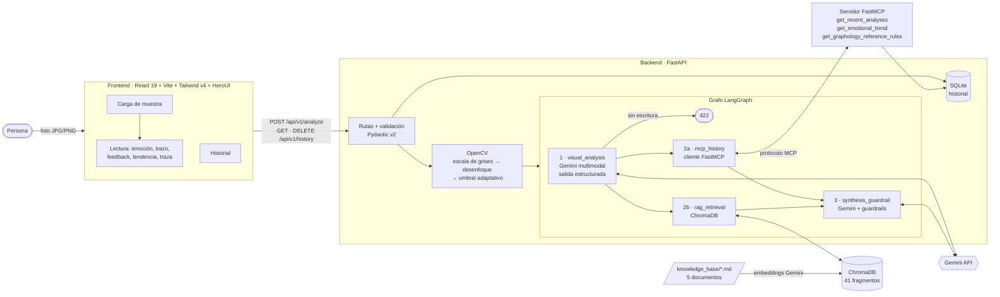

# Handwriting GenAI Coach

Coach de bienestar emocional **preventivo** que lee una foto de texto escrito a mano. Un agente multimodal (Gemini + LangGraph) describe el trazo y transcribe lo escrito. Después cruza el resultado con el historial de la persona (MCP) y con una base de conocimiento validada (RAG), y devuelve una lectura orientativa con recomendaciones citadas. No diagnostica: está diseñado con guardrails éticos explícitos.

> **Alcance:** herramienta de bienestar con fines orientativos y preventivos. No constituye un diagnóstico clínico ni sustituye la evaluación de un profesional de la salud mental.

---

## Índice

1. [Problema práctico](#1-problema-práctico)
2. [Por qué GenAI multimodal + RAG y no un clasificador CNN](#2-por-qué-genai-multimodal--rag-y-no-un-clasificador-cnn)
3. [Arquitectura](#3-arquitectura)
4. [Instalación y reproducción local](#4-instalación-y-reproducción-local)
5. [API](#5-api)
6. [Resultados, métricas y limitaciones](#6-resultados-métricas-y-limitaciones)
7. [Ética, privacidad y seguridad](#7-ética-privacidad-y-seguridad)
8. [Estructura del repositorio](#8-estructura-del-repositorio)

---

## 1. Problema práctico

El estrés académico y laboral, la ansiedad y el ánimo bajo suelen detectarse tarde: la persona no lo nombra hasta que interfiere con su vida diaria. Escribir a mano, en un diario, unas notas o una lista de pendientes, es un hábito cotidiano que deja dos señales a la vez:

- **lo que se escribe**, el contenido (preocupaciones, carga, cansancio);
- **cómo se escribe**, el trazo (presión, ritmo, espaciado, regularidad), que cambia con la activación y la fatiga.

El proyecto convierte ese hábito en un **punto de control preventivo de bajo coste**. La persona fotografía una hoja y recibe:

1. una **lectura orientativa** (`neutral`, `anxiety`, `stress` o `depression`) con su nivel de confianza;
2. **cinco indicadores del trazo** puntuados de 0 a 100, cada uno con una observación concreta;
3. una **retroalimentación personalizada** con técnicas de autocuidado **citadas** de una base de conocimiento;
4. su **tendencia en el tiempo**: si el estrés o la ansiedad se repiten, el sistema eleva el nivel de alerta y sugiere apoyo profesional;
5. un **protocolo de seguridad** cuando el texto contiene expresiones de riesgo.

El valor está en el seguimiento longitudinal y en la orientación hacia recursos, no en una etiqueta aislada.

---

## 2. Por qué GenAI multimodal + RAG y no un clasificador CNN

La alternativa clásica sería entrenar una red convolucional (CNN) que reciba la imagen y devuelva una de cuatro clases. Para este problema concreto, ese enfoque falla en puntos estructurales, no solo de precisión:

| Necesidad del problema | Clasificador CNN tradicional | GenAI multimodal + RAG (este proyecto) |
|---|---|---|
| **Datos de entrenamiento** | Necesita miles de imágenes etiquetadas con estado emocional. Ese dataset no existe en abierto, las etiquetas son subjetivas y recogerlas implica datos de salud sensibles. | *Zero/few-shot*: el modelo ya sabe leer escritura; se guía con un prompt con escala explícita y 4 ejemplos. Sin entrenamiento ni datos sensibles. |
| **Leer el contenido** | Ve píxeles, no lee palabras. Una nota sobre "no he dormido y mañana entrego dos trabajos" es invisible para una CNN de forma. | Transcribe y entiende el texto. El contenido es la señal **principal** y el trazo la secundaria, como establece la base de conocimiento. |
| **Contradicciones forma–contenido** | Solo tiene una entrada; no puede ponderar letra ordenada frente a contenido de estrés. | Combina ambas fuentes, baja la confianza si discrepan y lo explica (caso 2 de la evaluación). |
| **Explicabilidad** | Devuelve una clase y una probabilidad. | Salida **estructurada** (Pydantic): 5 indicadores con su observación, resumen visual y transcripción. Cada decisión es auditable. |
| **Imágenes fuera de dominio** | Clasifica cualquier cosa, incluso un paisaje, en una de sus 4 clases (problema de *open set*). | Paso explícito "¿hay escritura manuscrita?": rechaza paisajes, hojas en blanco y texto impreso con **HTTP 422** y un motivo. |
| **Recomendaciones** | No genera texto; habría que añadir reglas fijas. | Redacta retroalimentación **fundamentada (RAG)** en documentos curados y **cita** la fuente; las citas a documentos no recuperados se eliminan. |
| **Personalización en el tiempo** | Cada predicción es independiente. | Consulta el historial vía **MCP** (recurrencia, racha y nivel de alerta) e integra esa tendencia en la redacción. |
| **Seguridad** | Sin capa de lenguaje. | Guardrails deterministas (detector de crisis, aviso clínico obligatorio y prohibición de diagnosticar) además de los del prompt. |
| **Mantenimiento** | Reentrenar para cambiar criterios. | Cambiar criterios es editar `knowledge_base/*.md`: el índice se regenera solo. |

**Costes que asumimos a cambio:** mayor latencia (decenas de segundos frente a milisegundos), dependencia de un proveedor externo, salidas no deterministas y coste por petición. Se mitigan con reintentos y backoff, plazos por petición, nodos degradables, validación estricta del esquema y una evaluación sistemática que mide estos efectos ([sección 6](#6-resultados-métricas-y-limitaciones)).

---

## 3. Arquitectura



<details>
<summary>Versión ASCII</summary>

```
 Navegador (React + Vite)
   │  POST /api/v1/analyze (foto + perfil)
   ▼
 FastAPI ──► validación (PNG/JPEG ≤ 10 MB, antibomba) ──► OpenCV (gris → blur → umbral adaptativo)
   │
   ▼
 LangGraph
   START → [1] visual_analysis (Gemini multimodal, original + binarizada → JSON estructurado)
              │ sin escritura ─────────────────────────────────────────────► 422 + motivo
              ├──► [2a] mcp_history ──(FastMCP en memoria)──► SQLite: tendencia, recurrencia, reglas
              └──► [2b] rag_retrieval ──(embeddings)──────────► ChromaDB ◄── knowledge_base/*.md
                         (2a y 2b en paralelo; ambos degradables)
                                   ▼
            [3] synthesis_guardrail (Gemini) → citas validadas + crisis + aviso clínico → END
   │
   ▼
 SQLite (historial)  ──►  respuesta JSON con traza y latencia por nodo
```
</details>

### Componentes

| Capa | Tecnología | Responsabilidad |
|---|---|---|
| Interfaz | React 19, Vite 8, Tailwind CSS v4, HeroUI v3 | Carga con validación, progreso por etapas, cancelación, lectura en tarjetas, historial por perfil, tema claro/oscuro, WCAG AA |
| API | FastAPI, Pydantic v2 | Contratos tipados, errores HTTP semánticos (400/422/429/502/503/504), CORS |
| Visión clásica | OpenCV, Pillow | Validación de integridad, orientación EXIF, binarización adaptativa que elimina sombras y ruido de fondo para el VLM |
| Orquestación | LangGraph | Grafo con ramificación condicional, ejecución paralela, traza y latencia por nodo |
| Modelo | Gemini (LangChain `langchain-google-genai`) | Análisis multimodal con salida estructurada, redacción y embeddings |
| Memoria longitudinal | FastMCP + SQLAlchemy async + SQLite | 3 herramientas MCP de solo lectura; también se exponen como servidor MCP independiente (stdio) |
| Conocimiento | ChromaDB + `knowledge_base/` | 5 documentos curados (ansiedad, estrés, ánimo bajo, indicadores del trazo y límites éticos), troceados en 41 fragmentos |
| Resiliencia | tenacity | Reintentos con backoff exponencial y *jitter* ante 429/5xx/timeouts, con presupuesto total por operación |

### Decisiones clave

- **Dos imágenes al VLM:** la foto original, para transcribir y estimar la presión por la carga de tinta, y la versión binarizada, para medir forma, ritmo y espaciado sin ruido de fondo.
- **Nodos críticos y nodos degradables:** si fallan el MCP o el RAG, el análisis continúa y la traza lo marca como `degraded`. Si falla Gemini en un nodo crítico, la API devuelve un error explícito.
- **Guardrails en código, no solo en el prompt:** el detector de crisis, la validación de citas y el aviso clínico se aplican de forma determinista después de la generación.

---

## 4. Instalación y reproducción local

### Requisitos

- Python 3.14 (probado con 3.14.6)
- Node.js 24 (probado con 24.16) y npm
- Una clave de la API de Gemini ([Google AI Studio](https://aistudio.google.com/apikey))

### 4.1 Backend

```bash
cd backend
python -m venv .venv
# Windows
.venv\Scripts\activate
# macOS / Linux
source .venv/bin/activate

pip install -r requirements.txt
```

Crea `backend/.env` (o `.env` en la raíz) a partir de la plantilla y pon tu clave:

```bash
cp ../.env.example .env     # en Windows: copy ..\.env.example .env
```

```dotenv
GEMINI_API_KEY=tu_clave
GEMINI_MODEL=gemini-3.5-flash
GEMINI_THINKING_LEVEL=low          # reduce la latencia en Gemini 3.x
GEMINI_EMBEDDING_MODEL=models/gemini-embedding-001
DATABASE_URL=sqlite+aiosqlite:///./handwriting.db
```

Arranca la API (desde `backend/`):

```bash
uvicorn app.main:app --reload --port 8000
```

- Comprobación: <http://localhost:8000/health> y documentación interactiva en <http://localhost:8000/docs>.
- El índice RAG se crea solo en el primer análisis y se regenera si cambia `knowledge_base/`. Para precalcularlo: `python -m app.rag.retriever`.
- Servidor MCP independiente (para MCP Inspector o Claude Desktop): `python -m app.mcp_server.server`.

### 4.2 Frontend

```bash
cd frontend
npm install
cp .env.example .env        # VITE_API_BASE_URL=http://localhost:8000/api/v1
npm run dev                 # http://localhost:5173
```

Compilación de producción: `npm run build` (salida en `frontend/dist/`).

### 4.3 Pruebas y evaluación

```bash
cd backend
python -m pytest                     # 56 pruebas: API, grafo, MCP, RAG, guardrails, OpenCV (Gemini simulado)
python ../evals/run_eval.py          # evaluación contra el backend real con Gemini real (ver evals/README.md)
```

### 4.4 Recorrido de reproducción

1. Arranca el backend y el frontend como se indica arriba.
2. Abre <http://localhost:5173>, escribe un perfil (p. ej. `maria-diario`) y sube una foto de una nota manuscrita. Sirven las de `evals/samples/generated/`.
3. Revisa la lectura: emoción y confianza, rasgos destacados, transcripción, indicadores, retroalimentación con citas y la pestaña **Traza LangGraph** con los tiempos reales de cada nodo.
4. Sube 3 muestras de estrés con el mismo perfil y observa cómo **Historial MCP** pasa a `Vigilar` y después a `Alerta elevada`.
5. Sube una foto sin escritura (un paisaje): la API responde **422** y la interfaz explica cómo corregirlo.

---

## 5. API

Base: `http://localhost:8000/api/v1`

| Método | Ruta | Descripción | Respuestas |
|---|---|---|---|
| `POST` | `/analyze` | `multipart/form-data`: `file` (PNG/JPEG ≤ 10 MB) y `profile_name` (`[A-Za-z0-9_-]{1,64}`) | `200` análisis completo · `400` archivo inválido · `422` sin escritura manuscrita · `429/502/503/504` errores de Gemini |
| `GET` | `/history?profile_name=&limit=&offset=` | Historial, del más reciente al más antiguo | `200` |
| `DELETE` | `/history?profile_name=` | Borra los análisis (de un perfil o todos) y sus imágenes | `200 {deleted, profile_name}` |
| `GET` | `/health` (fuera de `/api/v1`) | Estado del servicio | `200` |

La respuesta de `/analyze` incluye `emotion`, `confidence`, `visual_indicators` (5 × `{score, observation}`), `transcribed_text`, `feedback` (Markdown), `rag_sources` (con `cited`), `cited_sources`, `history.trend` (tendencia MCP), `risk_flags`, `trace` (estado y duración de cada nodo) y `latency_ms`.

---

## 6. Resultados, métricas y limitaciones

<!-- EVAL_RESULTS -->

---

## 7. Ética, privacidad y seguridad

- **No diagnóstico:** el prompt obliga a usar lenguaje condicional. El aviso clínico se añade siempre en código, y la evaluación comprueba que aparece y que no hay frases diagnósticas.
- **Protocolo de crisis:** si la transcripción contiene expresiones de riesgo, la retroalimentación empieza con un mensaje de seguridad con teléfonos de emergencia (112/911) y líneas de crisis (024 en España, 988 en EE. UU.), y la interfaz lo destaca.
- **Citas verificables:** solo se conservan las citas a documentos realmente recuperados; las demás se eliminan antes de responder.
- **Datos locales:** las imágenes se guardan en `backend/uploads/` y los análisis en SQLite, en tu máquina. `DELETE /history` (o "Borrar historial" en la interfaz) elimina los registros y los archivos.
- **Inyección de instrucciones:** el texto transcrito se trata como dato y los prompts indican explícitamente no seguir instrucciones que contenga.
- **Demo sin autenticación:** los perfiles son etiquetas, no cuentas. Para un despliegue real harían falta autenticación, cifrado en reposo y consentimiento informado.

---

## 8. Estructura del repositorio

```
├── backend/
│   ├── app/
│   │   ├── agent/        # grafo LangGraph, prompts, esquemas de salida estructurada
│   │   ├── api/          # rutas FastAPI
│   │   ├── core/         # configuración, base de datos, cliente Gemini con reintentos
│   │   ├── mcp_server/   # servidor FastMCP (3 herramientas sobre el historial)
│   │   ├── models/       # modelos SQLAlchemy y esquemas Pydantic de la API
│   │   ├── rag/          # indexado y recuperación con ChromaDB
│   │   └── services/     # validación y preprocesado OpenCV
│   ├── tests/            # 56 pruebas (pytest)
│   └── requirements.txt
├── frontend/             # React 19 + Vite + Tailwind v4 + HeroUI
├── knowledge_base/       # 5 documentos curados para el RAG
├── evals/                # evaluación sistemática (run_eval.py, results.json)
└── .env.example
```
